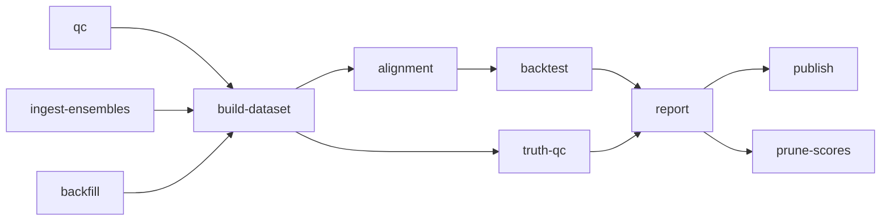

# CLI reference

Complete reference for every command and flag. For a guided first run see
[Getting started](../getting-started.md); for the reasoning behind the pipeline
order see [Advanced usage](../advanced-usage.md).

```
grounded-weather-forecast [--config CONFIG] [--version] <command> [options]
```

The entry point is `grounded_weather_forecast.cli:main`. Once a command has
parsed and its configuration has loaded successfully, its outcome is appended
to the **run ledger** (`data/runs.parquet`, pruned to 90 days / 50k rows), so
`report` can tell you what actually ran. Help, `--version`, parse failures, and
configuration failures occur before ledgering. `read-daily-report` explicitly
returns before the recorder and never appends an invocation. The optional `error_detail` stores
a single-line failure message capped at 400 characters, separately from the
exception class in `error`. Older ledgers read with null detail. Handled truth-QC
failures record the message for both standalone invocations and maintenance stages.
When present, exception class and detail appear together in QC refresh warnings.
Maintenance stages link to the parent invocation through `parent_run_id`. The
parent keeps its maintenance options; the QC child records its own `{"days": N}`
options. `failure_kind` belongs to the originating stage and is not inherited by
unrelated child stages.

The additive nullable `failure_details_json` field holds component diagnostics
(`stage`, `exit_code`, `failure_kind`, `detail`), with each detail normalized and
capped at 400 characters. A backtest records evaluation and promotion failures
together in its existing journal row. Real product failures take precedence over
promotion-only errors and pending outcomes; they stop routine maintenance even
when promotion also fails. Older rows load with a null field. This does not
change the daily-report v1 JSON contract or existing summary counters.
Pruning also records informational `retention_verification` components with exit
code 0 and `retention_clear` or `retention_suspended`. These do not set the
invocation's failure kind or increase failed-run counters. Reports/dashboard show
the latest completed check and its timestamp; legacy rows without this explicit
metadata mean not recorded, never verified clean.
The standalone wrapper supplies an invocation-local private outcome file to its
backtest child. It checks the recorded classification against the process exit;
missing or invalid metadata cannot exempt an evaluation failure. The file is
removed after the stage and does not replace the durable run journal.

---

## Global options

| Flag | Type | Default | Meaning |
|---|---|---|---|
| `--config CONFIG` | path | `config.toml` | path to the TOML configuration |
| `--version` | flag | — | print the version and exit |
| `-h`, `--help` | flag | — | help for the program or a subcommand |

### Exit codes

| Code | Meaning |
|---|---|
| `0` | success |
| `1` | command-level failure — missing or unusable inputs, no evaluable scores despite adequate history, no scores to report, a backfill error, directory-guard release failure during score recovery or an uncommitted score write, or reuse of a directory whose guard release failed; `prune-scores` finishes retention before returning 1 for a recovery release failure |
| `2` | configuration error, or an unknown command |
| `3` | evaluation pending: validated, applicable inputs cannot yet reach the first test origin, or usable training awaits future test truth at the snapshot cutoff; also returned for partial product completion while any applicable requested product is pending |
| `75` | pipeline, dataset-publication, score-directory, or automatic-recovery lock contention (EX_TEMPFAIL — retry later) |

Note that `truth-qc` returns `0` even when it finds no evaluable checks. A cold
start is not a fault, and an operator's cron should not page on one.

### Concurrency

`build-dataset`, `backtest`, `report`, `alignment`, `backfill`, `truth-qc`, and
`prune-scores` serialize on an exclusive lock at `<dataset dir>/pipeline.lock`.
A second interactive mutator waits up to 60 s, then exits `75`. `maintain`
instead waits indefinitely and holds that lock once across its entire four-step
transaction. `recover` deduplicates itself on `auto-restore.lock`, waits for the
pipeline lock, and rechecks whether work is still necessary before running.

Dataset publication has a separate short `<dataset dir>/dataset.lock`.
`build-dataset` stages every live parquet and the manifest, acquires that lock,
replaces all parquets, then replaces the manifest last. `predict` and `publish`
copy and validate all live files under that lock, waiting up to 60 s before
exiting `75`. Selection and fitting use the pinned in-memory snapshot after
releasing the lock, so serving sees one complete dataset publication. They do not wait
behind an hour-long backtest or report. `ingest-ensembles` keeps its own
store-level lock and runs freely alongside the chain.

---

## `read-daily-report`

Read the existing project forecast and health evidence as one JSON document on
stdout. This is a separate reader, not `predict`, `report`, `qc`, or maintenance.
It does not collect, fit, publish, regenerate, repair, install, acquire file locks,
write telemetry/evidence, or change data, schedules, or services. It never
substitutes an external forecast. Use the already installed environment and
disable Python bytecode writes; do not run `uv run` in a read-only automation.

From the repository root, the exact caller is:

```bash
.venv/bin/python -B -m grounded_weather_forecast.cli --config config.toml read-daily-report \
  --start 2026-10-22T07:00:00-07:00 \
  --as-of 2026-10-22T07:20:00-07:00 --hours 12 --forecast forecast.json
```

| Flag | Contract |
|---|---|
| `--start` | Required scheduled report start, ISO 8601 with explicit UTC offset; must be on an absolute hour. The caller resolves 07:00 in `America/Los_Angeles` for the scheduled date, using its IANA timezone rules. Never derive start from delayed execution time. |
| `--as-of` | Required execution cutoff with explicit offset, at or after `start`. Even execution after 19:00 preserves the scheduled window; stale/missing data remains explicit. Future-issued forecasts and future-recorded evidence are excluded. This reads current files and cannot reconstruct past overwritten artifacts. |
| `--hours` | Default 12; any other value is rejected. Twelve elapsed UTC hours with an exclusive end. At 07:00 Pacific this is `[07:00, 19:00)` on both DST transition dates. Offsets change from `-07:00` to `-08:00` in winter. |
| `--forecast` | Existing schema-6 forecast path, default `forecast.json`, relative to caller working directory. Unknown source versions are rejected. |
| `--published-station` | Optional fallback JSON path; default `~/Library/Application Support/grounded-weather-forecast/staged/current.json`, resolved at invocation from `$HOME`, or the system home lookup when unset; an empty or invalid home requires an explicit override. Only `metadata.observed_at` is read into the result, labeled `published_station_snapshot`. It is not a live station observation query or a forecast source. |

Exit `0` means a structured read completed, including partial/unknown data. Exit
`2` means invalid configuration, time range or final JSON serialization and returns a schema-1 JSON error;
argparse syntax errors use its normal stderr/exit 2. Missing or corrupt artifacts
do not prevent other components from reporting. Reject unknown output versions.

The machine-readable [schema-1 envelope](daily-report-v1.schema.json) and
[selection/freshness rules](../methods/daily-report.md) define the contract.
An accepted invocation always returns:

| Field | Meaning |
|---|---|
| `schema_version`, `as_of` | Integer `1` and the normalized UTC cutoff. |
| `window` | UTC `start`, exclusive `end`, `hours=12`, configured IANA `timezone`, offset-bearing `local_start`/`local_end`, `end_exclusive=true`. |
| `forecast` | Component status/limitations; when readable, original forecast status/reason, source schema, issue/observation dates, dataset fingerprint, release IDs, units, freshness, coverage, and twelve hourly rows. |
| `forecast.hourly[]` | UTC/local valid time, lead bucket, canonical values, methods, per-variable release IDs, truth semantics, selection reasons, and separate missing/null/invalid-variable arrays. Missing/duplicate hours have null values; duplicates are never arbitrarily selected. Numeric nulls remain null; no rain/temperature aggregate is invented. |
| `operational_health` | Independent `station`, `providers`, `runs`, `pipeline` components. Provider rows expose attempts, successes/failures, rate, latest outcome/completion and freshness over `(as_of - 24h)` through `as_of`. No raw provider payloads or error messages. Provider rates use the configured coordinate tolerance. Runs expose the latest completed relevant outcome at/before the cutoff with per-command freshness, including expected pending evaluation; old outcomes remain visible as stale. |
| `prediction_quality` | Independent `backtest`, `realized_live`, `truth_qc`, `drift` components. Scores match the forecast slice and its recorded selection provenance. Backtest rows use the selection's evaluation dataset, code and configuration. Realized rows prefer the exact release, then explicitly attributed compatible older evidence. Includes MAE in that variable's declared unit, `n`, evaluation/record dates and freshness. Backtest on live-origin inputs is still a backtest, never a realized live score. |
| `limitations` | Machine-readable limitation codes. No claim of a global transaction across independently maintained sources. |

Component `status` describes availability (`ok`, `partial`, `unknown`,
`available`, `insufficient`, `stale`, `historical`), not a single prediction-health
grade. Examine original `forecast_status`, provider `latest_status`, run
`status`, freshness, and quality sample counts separately. Unknown components
have `status` and `limitations`; their unavailable payload fields are absent.
`freshness` has `status` (`fresh`, `stale`, `unknown`), `at`, `age_minutes`,
`max_age_minutes`; future timestamps are unknown. Historical alarms are labeled
and never converted into current operational failures. Current legacy drift
artifacts lack dataset/time attribution, so current drift is explicitly unknown.
Date-only truth-QC uses the same conservative interval and failed-refresh assessment
as the dashboard, retaining a null exact refresh instant. Optional null flags do
not erase usable evidence. Malformed optional verdicts retain valid freshness and
alerts with a limitation.

The reader never opens a source database with SQLite. It validates rollback-mode
bytes and associated-file signatures, deserializes only into memory and enables
query-only/memory-temporary mode. WAL, journal-dependent or unverifiable sources
are refused. Station reads use the explicitly labelled JSON fallback and expose
`published_station_path`; provider data becomes unknown. No source sidecars or
temporary disk snapshots are created. The default fallback resolves lazily, and an
explicit `--published-station` avoids home lookup.

Realized slices add nullable `evidence_match` (`exact_release` or
`compatible_release`), `evidence_release_id`, `evidence_dataset_fingerprint` and
`latest_scored_issue_at` (UTC, or null for legacy/unusable recency metadata, no matching evidence, and errored realized slices).
The existing `release_id` describes the forecast. A fallback adds
`older_compatible_release_evidence`; it selects one existing cohort without pooling.
Exact rows take precedence even when stale or insufficient. Missing modern
source/feature/code/configuration/semantic compatibility prevents fallback.
Realized ledger code identifies its recorder and does not have to equal the
selection's evaluation code. Backtest code matching remains exact. Fallback
requires strictly earlier immutable content publication; equal, later or invalid
publication clocks cannot establish older evidence.

Evidence date and recording time establish priority. When every remaining tied
row has a valid timezone-aware scored-issue clock at or before its recording time,
the latest `latest_scored_issue_at` wins, then the forecast dataset is preferred.
The clock describes forecasts actually matched to truth and scored; dataset IDs,
file times and sample counts never substitute for it. Missing, naive, malformed or
future clocks disable that tie-break for the whole tied group. Legacy rows retain
dataset preference and ambiguity handling. Identical duplicates coalesce. Remaining distinct ties
produce `ambiguous_quality_evidence`, including exact rows, without enabling
fallback or pooling. Method-bearing slices missing release attribution remain
unknown; only method-free missing-hour placeholders are omitted.

Run health filters command/record-kind eligibility before validating fields.
`superseded_invalid_run_rows` is informational when every damaged row is provably
older than a valid result; it does not make current health partial. Newer, equally
timed or unorderable damaged evidence leaves its command unknown with
`invalid_run_rows`. Independent commands remain available. Otherwise valid rows
without an ending time are incomplete and skipped. Exact start/end ties use the last persisted ledger row, shared with truth-QC and pruning assessment. A non-null timezone with no UTC offset is rejected rather than interpreted as local time. `no_completed_runs_as_of`
means no usable completed run exists at the cutoff, not merely within 24 hours.

Compatible fallback inspects descending date/recording groups and stops after the
first group with compatible evidence, checking all its tied candidates. Older
irrelevant releases are not read or added as retry dependencies. Eligibility is cached per release/slice within an attempt; older time groups are traversed incrementally. Each distinct
release is parsed once per stable attempt. Every component has its
own initial read and one retry, including components first affected during another
component's retry. Repeated changes leave only exhausted affected components unknown
while unrelated evidence remains available.

Source reads use independent stable snapshots. Repeated changes yield the same
envelope with only affected components unknown and
`concurrent_replacement_after_retry`. Station database failure permits the labelled
published snapshot fallback; if that fails, station health remains unknown and
reports the attempted fallback path.

Keep the existing 07:00 America/Los_Angeles automation on its verified reader
until this interface is merged/available and validated in its actual checkout.
Do not add a scheduler. Maintenance may still run at 07:00: independent file
snapshots, precise cutoffs and unknown evidence support overlapping work.

---

## Pipeline order

Commands are independent, but they consume each other's outputs. A cold start
runs roughly:



Steady state is four crons — see [Scheduling](../scheduling.md).

---

## Memory profiling with Memray

From a source checkout, install the opt-in profiling dependencies once:

```bash
uv sync --locked --group profiling
```

Wrap any forecast CLI command without changing its application code:

```bash
uv run --locked --group profiling python scripts/profile_memory.py -- maintain
uv run --locked --group profiling python scripts/profile_memory.py \
  --trace-python-allocators -- --config config.toml backtest --source live
```

Arguments before `--` belong to the profiling wrapper; everything after it
is passed unchanged to `grounded_weather_forecast.cli`. The wrapper preserves
the application's working directory, stdout, stderr, and exit status. Profiling
messages and report-generation output go to stderr. If the application succeeds
but report generation fails, the wrapper exits `1` and retains the capture.
Captures may still be incomplete after a hard kill or an out-of-memory crash.

Each invocation creates a unique UTC-timestamped directory under
`artifacts/memory/`, containing `capture.bin` and `peak.html`. The report shows
allocation call paths contributing to peak tracked heap usage, rather than
cumulative allocation volume or exact process RSS. Native C/C++ stack frames
are enabled by default; symbol availability in macOS wheels can limit their
detail. Individual small Python objects require `--trace-python-allocators`.

| Wrapper flag | Default | Meaning |
|---|---|---|
| `--output-dir PATH` | `artifacts/memory` | parent directory for unique per-run directories; relative paths use the current working directory |
| `--trace-python-allocators` | off | trace individual small Python allocations; increases runtime overhead and capture size |
| `--no-native` | off | omit native stack frames while continuing to track native allocations |
| `--no-report` | off | save only `capture.bin`; generate reports later |

The profiling dependency group supports Memray's macOS/Linux environments and
is not part of the application's runtime dependencies. Include `--group profiling`
on each `uv run` so environment synchronization keeps Memray available.
Existing schedules remain opt-in; see [Scheduling](../scheduling.md#profiling-a-scheduled-run).

For later analysis, generate reports on the same machine as the capture,
especially when native stacks are enabled. Replace `RUN_DIRECTORY` with the
timestamped directory printed by the wrapper:

```bash
uv run --locked --group profiling memray summary RUN_DIRECTORY/capture.bin
uv run --locked --group profiling memray flamegraph --temporal --no-web \
  -o RUN_DIRECTORY/temporal.html RUN_DIRECTORY/capture.bin
```

Temporal reports let you focus on the memory peak within a selected time range.
The `--leaks` reporter option means allocations not freed when tracking ended;
it does not by itself prove that the application leaked memory. The generated
files are ignored by Git; no captures are automatically deleted, so prune
unneeded runs periodically. See the [Memray documentation](https://bloomberg.github.io/memray/)
for report interpretation and profiling limitations.

### Selection memory benchmark

From a source checkout, compare complete `select_methods` runs against the
original PR #46 implementation:

```bash
uv run python scripts/benchmark_selection_memory.py \
  --baseline a4ec76d --runs 3 --evaluations 12 --cases 4000
```

| Benchmark flag | Default | Meaning |
|---|---|---|
| `--baseline REF` | `a4ec76d` | local Git revision whose `src` tree is extracted for comparison |
| `--runs N` | `3` | fresh processes per variant and scenario; minimum three |
| `--evaluations N` | `12` | positive count of evaluation files per scenario |
| `--cases N` | `4000` | positive cases per method in each large evaluation; the sole compatible evaluation in the mostly-incompatible scenario has 80 |

Fixtures and release artifacts stay in a temporary directory. Each worker
uses the same Python environment and its designated source tree. JSON lines
report median process peak RSS, min/max spread, runtime, and individual
samples. The runner verifies that selection payload hashes agree across all
variants and repetitions. No memory threshold is enforced in CI. See the
[dated results](../research/selection-memory-2026-10-07.md) for scope and measurements.

### Backtest memory benchmark

Compare score construction and persistence using an immutable pre-streaming
source snapshot and the current source tree:

```bash
uv run python scripts/benchmark_backtest_memory.py \
  --baseline ee93d83 --runs 3 --rows 500000 2000000
```

| Flag | Default | Meaning |
|---|---|---|
| `--baseline REF` | `ee93d83` | local Git revision whose `src` tree is extracted for comparison |
| `--runs N` | `3` | fresh processes per variant and row count; minimum three |
| `--rows N [N ...]` | `500000 2000000` | distinct positive output row counts |
| `--output PATH` | unique ignored path | new JSONL destination; follows the output handling below |

The fixed workload alternates point scores with 19-level quantile scores and
repeats an 8,449-byte feature-description JSON value. Inputs are generated in
16,384-row chunks with fixed clocks and identities. Workers verify source
origins; the runner checks immutable source and runner hashes and exact logical
score-value hashes, including row order, schema and nulls. Parquet bytes may
differ because row groups and encodings differ. No live dataset is modified.

Samples report elapsed time, file size and peak RSS. On macOS they additionally
record `vmmap` peak physical footprint and current compressed memory, before
verification readers allocate buffers. With the default row counts, acceptance
requires at least 50% lower median peak physical footprint at two million rows
and no more than 128 MiB growth when the candidate output grows fourfold.
Failed acceptance returns exit 1 after publishing measurements. Other platforms
report RSS but leave physical-footprint acceptance unassessed. These thresholds
apply to score construction/writing, not model-fitting memory, and are not CI
performance gates.

### Benchmark output safety and recovery

The fitting, score-reader and backtest-memory runners share output handling. With no `--output`,
each uses a unique UTC timestamp-and-UUID JSONL under the repository's ignored
`reports/benchmarks/`, with a `fit-diagnostics-`, `score-readers-` or
`backtest-memory-` prefix.
Explicit relative paths use the caller's working directory; absolute paths are
used as given. Validated runs also write a `.summary.json` and print both paths.

Before Git, fixture generation, or workers, both runners reject existing files,
directories, or symlinks at registered destinations and create/probe the parent
with an actual temporary write and flush. Invalid or unwritable output paths
exit `2`. Primary destinations include samples and summary only; mismatch
`.payloads.json` diagnostics are written exclusively to recovery paths. An
existing primary payload sidecar does not block a run. There is no overwrite
option.

Before Git or workers start, each runner exclusively opens a unique
`*-journal-*.jsonl` under the repository's ignored `reports/benchmarks/` and
immediately prints its absolute path. Every completed sample is appended and
flushed outside measured worker timings. Acknowledged checkpoints survive
process termination, including SIGKILL or OOM-kill of the runner. There is no
`fsync`, so power-loss durability is not guaranteed. A journal may end in a
partial line if a write is interrupted; complete preceding lines remain usable.
Journals are retained after success and failure, contain raw potentially
unvalidated samples, and never have summaries. Journal preparation failures exit
`2` before measuring; checkpoint failures stop the run and trigger recovery.

The launchers explicitly resolve sibling tooling, supporting Python `-P`, `-I`,
and `PYTHONSAFEPATH=1` from another working directory. Workers retain inherited
environment settings and select their immutable source before package imports.

Publication opens every required output exclusively before writing, so late
collisions cannot overwrite evidence. Publication failures exit `1` and retain
destination files, which may be empty or incomplete. They are not rolled back
or automatically deleted. The runner attempts one rescue to unique ignored
`*-recovery-...` paths and reports those paths. If rescue also fails, both errors
and the available sample JSONL are printed to stderr.

Worker or validation failures preserve their original exception and traceback
after one best-effort rescue of collected samples. Secondary serialization,
recovery, reporting, closure, or interruption failures cannot replace that
exception. The retained journal remains available if rescue fails. Unvalidated runs omit the summary; score payload mismatches
also save diagnostic payloads. A recovery artifact does not make the run
successful. Choose new destinations when rerunning and inspect retained files
before removing them manually. Parent probing cannot guarantee later writes
will succeed.

Historical research memos describe their recorded runner versions, including
the output defaults at that time. Current reproduction commands use the safe
scratch defaults above; saving fresh results requires a new explicit path.
The dated documents, samples, summaries, and hashes remain historical evidence.

### Score-reader benchmark

Run `uv run python scripts/benchmark_score_readers.py` from a source checkout.
`--baseline REF` defaults to `6a4933f`; `--runs N` defaults to three fresh
processes per variant/workload/policy and must be at least three.
`--evaluations N` defaults to 12, and `--cases N` to 4,000; both must be positive.
`--output PATH` follows [shared output handling](#benchmark-output-safety-and-recovery).
Workloads cover selection with many evaluations or mostly incompatible evidence,
dashboard collection, and report rendering. Fixtures and immutable source trees
remain temporary, and payload hashes must agree. `full_load_calls` counts eager
score loads, excluding projected scans and batches. See the
[dated measurements](../research/score-readers-2026-10-11.md).

### Fitting diagnostics benchmark

Run `uv run python scripts/benchmark_fit_diagnostics.py` from a source checkout.
`--baseline REF` defaults to merged PR #54 (`2ccd7e0`); `--runs N` defaults to
three fresh processes per variant/workload/size; `--output PATH` follows
[shared output handling](#benchmark-output-safety-and-recovery).
Configurations and immutable source snapshots remain
in temporary directories. Fixed thread settings match the score-reader benchmark.

The workloads measure isolated diagnostic collection and real successful/pending
hourly fitting with 100,000 and one million raw rows. They exclude matrix I/O and
full forecast assembly, assert the fitting fixtures actually contain promoted
selections, and check equivalent point/method/release/quantile outputs.
Workers reject missing source trees, cached foreign imports, and unverifiable
module origins before accepting timings. Samples include verified source roots
and imported module paths, checked before variant selection and after warm-up.
See the [verified dated measurements](../research/fit-diagnostics-2026-10-13.md).

---

## `qc`

> summarize station truth quality control

No flags. Reads the station database and prints the observation span, a
per-channel QC summary (samples, nulls, and counts for each of `OUT_OF_BOUNDS`,
`SPIKE`, `FLATLINE`), and hourly/daily non-null truth counts.

**Run this first.** If your column mapping is wrong, this is where it shows up —
as a channel that is 100% null or 100% flagged — and every later command would
otherwise fail confusingly.

*Writes nothing.* See [Methods: truth and QC](../methods/truth-qc.md).

---

## `build-dataset`

> materialize truth tables and supervised matrices as parquet

No flags. The core ingest. Reads both SQLite files, applies QC, builds truth at
all three resolutions, reads the forecast archive into canonical long frames,
constructs as-of snapshots, and writes the supervised matrices.

**Writes** into `[dataset] dir` (default `data/`):

| File | Contents |
|---|---|
| `truth_minute.parquet`, `truth_hourly.parquet`, `truth_daily.parquet` | the aggregation ladder |
| `forecasts_long.parquet`, `daily_long.parquet`, `minutely_long.parquet` | canonical long frames |
| `hourly_matrix_live.parquet` | the supervised live hourly matrix |
| `daily_matrix_live.parquet` | the supervised live daily matrix |
| `manifest.json` | per-file SHA-256 and the **dataset fingerprint** |

The build is byte-reproducible: stable sorts precede every pivot, so the same
inputs give the same fingerprint. That fingerprint is what gates artifact
staleness and what serving checks before trusting a release.

Prints the fingerprint, source list, snapshot count, and per-file row counts with
a 16-character hash.

`build-dataset` does not write synthetic matrices. `backfill` writes
`hourly_matrix_synthetic.parquet` and `daily_matrix_synthetic.parquet` from
archive providers, keeping that provenance separate from live observations.

---

## Standalone launchd wrappers

The wrappers resolve the forecast project from their working directory, validate
its project identity, and parse `config.toml` once per wrapper invocation. The CLI
children perform full scientific configuration validation. Install `launchd_paths.py`
beside both wrappers with a matching runtime package. Missing runtime helpers produce
a logged configuration error instead of an import traceback.

`UV` takes precedence over executable discovery on `PATH`. An explicitly invalid
`UV` exits 2; it never silently selects another launcher. Symlink launcher paths
are preserved for macOS permission grants. Bad arguments and unavailable forecast
paths exit 2 with START/END logging; `--help` exits 0. Resolved project and forecast
output paths are logged after validation. Maintenance initializes the support
directory before taking its job lock; directory creation, lock opening and lock
acquisition setup errors exit 2. Duplicate-job contention still skips successfully;
later stage and stamp-update errors exit 1.

`hourly-predict-publish.py --station-project PATH` overrides the default sibling
`ambientweather2sqlite` checkout. This is a wrapper flag, not a core CLI flag.
Prediction runs before collector discovery. The station child runs with the
collector as both working directory and project, without `--db`, so existing
collector configuration owns the live station database independently of
`station.db_path` used for forecast evaluation. Collector/path/database errors,
permissions, and timeouts are station-stage failures: publish with existing staged
documents when available, otherwise refuse publication. Successful staged fallback
is logged explicitly.

## `backtest`

For the local launchd deployment, `docs/launchd/daily-maintenance.py` runs each
maintenance stage in a fresh child process so a completed backtest releases
its native allocator memory before report generation. The prediction wrapper
uses the same process boundary. Both wrappers limit Polars to two threads and
record `/usr/bin/time -l` peak memory and child exit status. A maintenance job
lock prevents duplicate wrappers and concurrent automatic restore attempts.
Backtest exit 3 leaves evaluation pending while daily maintenance and CLI
`maintain` continue diagnostics. They return 0 if all remaining required work
passes. The daily wrapper preserves `last-maintenance` whenever any applicable
live or scheduled synthetic evaluation is pending. All other nonzero child exits
remain failures; a later real failure overrides pending metadata. The wrapper
logs complete stage commands and skips pruning after any report failure,
including a report command with arguments.

Validated, nonempty applicable inputs receive `failure_kind="no_folds"` and
exit 3 for either insufficient issue-time history or expected future test truth.
The first origin needs an issue span greater than `initial_train_days`, plus
usable training data. `awaiting_truth` requires usable training and all otherwise
eligible test targets still future at the dataset snapshot cutoff. Already-due
missing observations, invalid schema, empty matrices, and missing usable training
remain failures. Any positive score output completes that product.

The cutoff comes from the selected inputs' hash-validated manifest: `manifest.json`
for live matrices, `manifest_synthetic.json` for new synthetic builds. Outcomes do
not change merely because wall time passes. Legacy matrices remain scoreable;
without trustworthy metadata, only the short-history exemption is available.
Rebuild the dataset/backfill to establish truth maturity. No file modification
time is used as a scientific clock.

Every independent applicable product is attempted. Real failures take precedence
over pending outcomes. Unsupported individual products are skipped before loading
files; unknown selections and entirely inapplicable requests exit 2 explicitly.
Only completed live products may receive new selections from that run, under the
existing gates. Compatible excluded incumbents and their evaluation contexts are
carried forward. Valid pending evaluations still write empty score files.

`pending_evaluations_24h` counts pending backtest invocations or embedded backtest
stages, including the current stage before report. A completed parent does not
count the same evaluation twice. Failed stages contribute one provisional failure
per pipeline until its parent is recorded. Legacy parent-only rows remain readable;
older pipeline-health rows have an unknown (null) pending count. Exceptions always
count as failures, even when pending evaluations also exist.

The daily wrapper reads `[maintenance].synthetic_backtest` from the active
configuration: `auto` (default), `required`, or `off`. On UTC Sundays, `auto`
runs synthetic evaluation when both hourly and daily matrices exist and skips
when both entries are absent in an accessible dataset directory. Broken links,
unavailable storage, partial inputs, and unreadable inputs fail. `required` also fails
when both are absent; `off` skips. Corrupt files fail in the backtest child.
Scheduling-only settings are validated after acquiring the job lock and before
checking the success stamp. Restore ignores synthetic scheduling settings,
remains live-only, and never updates the maintenance stamp. Unlike
routine maintenance, standalone `--restore` returns 3 after diagnostics if live
evaluation is pending. CLI `recover` stops at that pending result and returns 3;
neither claims restoration completed.


> rolling-origin backtest over the supervised matrices

| Flag | Choices / type | Default | Meaning |
|---|---|---|---|
| `--methods` | CSV or `all` | `all` | method ids to run; `all` means every registered method |
| `--hourly-variables` | CSV | `temp_c,humidity_pct,dew_point_c,wind_speed_ms,wind_gust_ms,pressure_sea_hpa,precip_mm,pop` | hourly variables to score |
| `--daily-variables` | CSV | `temp_max_c,temp_min_c,pop,precip_sum_mm` | daily variables to score |
| `--products` | CSV of `hourly`,`daily`,`minutely` | `hourly,daily,minutely` | which products to backtest |
| `--window` | `expanding` \| `rolling` | `expanding` | training window mode |
| `--source` | `live` \| `synthetic` | `live` | which provenance the matrices must carry |
| `--semantics` | `auto` \| `inst` \| `mean` | `auto` | hourly truth semantics |

Notes that matter:

- **`minutely` is live-only.** It scores the nine nowcast path constructions, and
  the synthetic archive has no sub-24h leads to score them on.
- **`--source` is a wall, not a filter.** Live and synthetic rows are never
  pooled; mixing raises `MixedProvenanceError`. See
  [Methods: verification §7](../methods/verification.md#7-the-provenance-wall).
- **`--semantics auto`** reads the majority recommendation from
  `artifacts/alignment.json`, falling back to `inst` when no study exists.
  Variables without dual semantics (gust, precip, PoP, daily extremes) always use
  `inst`.
- **`--window`** — `expanding` asks *what do you know?*, `rolling` (180 days)
  asks *what have you learned lately?* Both are reported; they answer different
  questions.

**Writes** `data/scores/scores_{product}_{kind}_{window}_{evaluation_id}.parquet`.
On live sources it promotes only completed products. Compatible approved choices
survive pending, failed, unrequested, or completed slices without a qualifying
replacement. The CLI prints a promoted release ID only when it creates that
immutable release; `approved model release` denotes the first approval of
content left by an interrupted run, and `reapproved model release` denotes content
with an earlier valid approval becoming current again. Unchanged decisions print
retained/unchanged.
Approval events are committed after content publication under one ledger lock;
A → B → A changes approval, while A → A records nothing new.

Current-time `predict` and `publish` read approved releases and never elect
methods, apply promotion-time live gates, or create release files. Elections and
live-gate method changes belong to live backtests. Scientific gates and
prediction-time safety guards retain their existing constants. The explicit
library `select_methods` mapping API remains a promotion compatibility adapter;
`promote_methods` returns `PromotionResult(selections, release_id, created,
approval_id, approval_changed, disposition, gate_verdicts, provenance)`. `disposition` is
`none`, `first`, `reapproval`, or `unchanged`; `gate_verdicts` contains typed
measurements independent of content identity. `provenance` captures the diagnostic
batch's immutable dataset/configuration/code identity. Telemetry is written after
the approval lock is released and remains best effort even if publication fails.
`created` means immutable content was created;
`approval_changed` means a new approval event committed. `approval_id` is nullable
for legacy implicit approvals. `load_approved_selections` is the read-only serving
interface. The library prediction marker distinguishes actually loaded approvals
from arbitrary caller-supplied selection maps.

A data-only rebuild can retain approvals when code, configuration, product
sources, exact feature set, and truth semantics still match. Each persisted
selection records its original `dataset_fingerprint`; evaluation contexts also
retain the original dataset, evaluation timestamp, and available training cutoff.
The release's top-level dataset identifies its creation dataset; forecast JSON
identifies the dataset actually used for this issuance. Historical replay keeps
its strict dataset and promotion-time rules. Legacy releases remain readable
using their recorded identity without fabricating missing context. Context-free
legacy approvals are accepted only on their recorded dataset, with matching code,
configuration and truth semantics. New `approval_required` release markers are
outside content identity: managed content without a committed event is ignored.
Legacy `promoted_at` provides an implicit approval; managed events provide ordered
`approval_id`, `release_id`, timezone-aware `approved_at`, nullable `visible_at`, and locked `sequence`
fields in `releases/approvals/`. Serving, incumbent lookup and historical replay
share timestamp validation and reject malformed, naive, and overflowing clocks.
Current managed approvals sort by committed sequence without wall-clock eligibility
checks. A corrected clock cannot restore an older decision. Historical readers
require publication, approval and visibility clocks within the cutoff. New events
set `visible_at` to the maximum of actual commit time, stored content publication
time, and preceding managed visibility floors. Older events derive the same floors
in sequence order without modifying artifacts. Actual clock readings remain in
`approved_at`; a valid reapproval can precede the stored publication clock.
Implicit legacy approvals retain publication-time eligibility behind managed events.
One immutable snapshot is shared throughout promotion and each dashboard render.
Explicit reader `as_of`/report `now` queries use historical visibility; operational
retention always protects current approval state. First versus repeated approval
is determined from committed history, independently of historical eligibility.
`active_release.json` still records the locally served document.
Dashboard lineage and retention fallback use this same approval order. Active or
recently served legacy references can separately protect scores even when their
clock cannot authorize serving; unreadable referenced artifacts suspend pruning
with an explicit reason. New release objects default to `approval_required=True`;
missing fields in stored JSON retain legacy interpretation.

Churn rows retain content publication time in `from/to_promoted_at`. Nullable
`from/to_approved_at`, `from/to_approval_sequence`, approval IDs, and
`clock_schema_version=2` identify approval transitions. Old rows are normalized in
memory using their event IDs and available immutable content; unrecoverable clocks
stay unknown. Historical artifacts are not rewritten. Dashboard grouping and detail
selection use transition identity, with managed sequence ordering, so repeated
A → B transitions remain distinct and report reruns remain idempotent.

Each selection adds nullable `training_cutoff`. Contexts sharing an evaluation ID
merge compatible selected-variable semantics after validating identity; unused
historical contexts are removed first. Known context-free legacy evaluation IDs
remain in the reference list. Newly evaluated selections require context.
A per-selection `legacy_context_missing` marker is inferred only through the
accepted context-free legacy path. Marked slices stay restricted to their exact
dataset and never borrow another variable's context. The old literal `"unknown"`
evaluation placeholder loads as absent provenance. Raw context APIs always validate
conflicts; a typed validated-context set permits one merge during promotion.
Conflicts return 1 with `failure_kind="promotion_evidence_conflict"`, evaluation ID,
field/variable and both values. Missing required context uses
`promotion_evidence_invalid`. No content or approval is published on either error;
completed scores and current approvals remain. Routine maintenance continues
truth-QC/report diagnostics when no evaluation failed, returns failure, and preserves the success stamp;
recovery cannot complete. Summaries are
recomputed from the selected slices' available cutoffs; a legacy aggregate cutoff
is not assigned to individual slices whose cutoff is unknown.

Build manifests add `truth_snapshot_at`, captured before the observation read.
`created_at` remains publication time. Synthetic truth and causal features share
one observation snapshot, and virtual synthetic issue times may be later than
either clock. Only a trustworthy truth cutoff can establish `awaiting_truth`.
Legacy manifests with only `created_at`, absent cutoffs, and malformed maturity
clocks permit positive scoring and valid short-history pending outcomes, but
cannot exempt mature zero-score output. Malformed manifests, hash mismatches,
corrupt matrices, and required schema errors remain failures. A sensor without
usable training does not veto another eligible slice awaiting future truth;
all-unusable training and overdue missing truth remain failures.

All products write compact score batches incrementally, with at most 65,536 rows
per batch/row group. The writer closes a temporary file before atomic publication;
a handled failure or interruption preserves an existing destination and attempts
to remove the temporary file. Disposal makes one zero-wait directory-guard
attempt. Contention or cleanup errors can leave a payload and/or lease companion
even after a handled failure or successful publication. These leftovers, like
those from abrupt termination, are eligible for a later backtest or `prune-scores`
recovery pass. Recovery is best effort and may defer work when coordination is busy.
Each writer leases its own private stage at
`.score-stage-v1.<score filename>.<16 lowercase hex>.tmp`, with a `.lease`
companion held through producer closure and atomic publication. Independent
files can be written concurrently in the same directory. Concurrent writers to
the same destination retain atomic last-replacement-wins semantics.

The persistent `.score-stage-v1.lock` coordinates only allocation, publication
and removal; it is never held during fitting, prediction or bulk writing.
Nested calls in the same process/thread share this short guard, including through
directory aliases. Each coordination acquisition waits at most **60 seconds**;
allocation and publication have independent budgets, so their combined waits
can approach **120 seconds**, excluding computation and other locks. Contention
that times out allocation or publication produces a score-specific diagnostic and exit code
**75** (`EXIT_CONTENTION`) from `backtest`, `maintain` or `recover`, releases
the pipeline lock and suppresses promotion. This is not a total command timeout.
A failed follow-up coordination probe after a product error returns 1 with
`failure_kind="score_coordination_probe"` and both primary and probe diagnostics.
Unknown ownership stops remaining score writers and suppresses all promotion;
this diagnostic is never treated as a product-local failure or pending evaluation.

Directory-guard release failure during startup recovery or an uncommitted write
returns **1** from these commands, with
`failure_kind="score_coordination_release"` and the diagnostic in the run journal's
`error_detail`. Startup recovery reports completed cleanup and partial counts/bytes,
then stops before invoking product writers. Writer failures close owned producers;
both paths release the pipeline lock and suppress promotion. Ordinary housekeeping
failure after publication remains a warning and does not turn a committed write
into failure. Any guard-release failure marks the directory by process/device/inode
identity until process exit. Later acquisitions in that process, including from
another thread or directory alias, immediately raise the saved release diagnostic
instead of waiting 60 seconds or returning 75. A fresh process has no such marker;
it still contends normally with any OS lock that remains held. Fork children reset
both the failure registry and its mutex. If the final product commits and only its
guard release fails, the warning alone does not fail backtest or suppress promotion.
Warnings
retain secondary exception notes and distinguish release attempts, retry outcomes
and the lease's final reported ownership state (`still held`, `reported released`
or `not held on entry`), together with whether companion removal completed.
Cleanup never waits behind another writer. Readers remain lock-free.
SIGTERM behavior is unchanged; SIGTERM, SIGKILL and OOM leftovers use next-run
recovery. Product-owned matrices and score generators are released before
the next product and before promotion. Stored score schemas, quantile JSON and
successful backtest output are unchanged. The batch limit is internal and has no
CLI/config knob.
Library callers of `run_backtest`/`run_minutely_backtest` still receive a complete
DataFrame; model fitting and fold plans retain their existing working sets.

---


### Approval publication compatibility

`promotion_publication_failed` covers expected release/event I/O, JSON and clock
validation errors; `promotion_snapshot_stale` rejects an election made before a
newer reservation appeared. Both preserve product diagnostics. Successful
evaluations permit maintenance truth-QC/report to continue with failure status;
real evaluation errors still stop maintenance, and no failure advances the stamp.
Readers ignore unknown additive event keys. Pre-#79 binaries need a reader
compatibility backport before rollback because their event constructor rejects
`visible_at`. Existing artifacts are never rewritten. Historical visibility floors
are deliberately conservative and uncapped; inspect the earliest elevated event
when a historical query excludes later approvals. Correcting the host clock fixes
current sequence-based serving, but does not rewrite historical visibility.

## `maintain`

> run the scheduled live maintenance transaction under one pipeline lock

| Flag | Choices / type | Default | Meaning |
|---|---|---|---|
| `--methods` | CSV or `all` | `all` | method ids passed to the live backtest |
| `--hourly-variables` | CSV | same as `backtest` | hourly variables passed to the live backtest |
| `--daily-variables` | CSV | same as `backtest` | daily variables passed to the live backtest |
| `--products` | CSV of `hourly`,`daily`,`minutely` | `hourly,daily,minutely` | products passed to the live backtest |
| `--window` | `expanding` \| `rolling` | `expanding` | training window passed to the live backtest |
| `--semantics` | `auto` \| `inst` \| `mean` | `auto` | hourly truth semantics passed to the live backtest |
| `--truth-qc-days` | int > 0 | `30` | neighbour history passed to truth-QC before report |

The source is always `live`. The command waits for `pipeline.lock`, then runs
`build-dataset` → `backtest --source live` → `truth-qc` → `report` while holding
that one lock. Build or backtest failure stops the pipeline. A handled truth-QC
failure is recorded before report starts and permits report to finish; report
failure retains its partial-output behavior. Maintenance returns the first
nonzero stage result, even if report succeeds. Unexpected exceptions still
propagate and stop the pipeline.

When truth-QC succeeds, report uses its refreshed artifact. A failed refresh
leaves the previous `truth_qc.json` unchanged, so report may use an older verdict
or have no verdict yet. Check the run ledger for the truth-QC stage result; a
completed report or refreshed dashboard does not mean maintenance succeeded.
The cross-check panel shows retained verdict freshness and the latest failed
refresh: amber after failure, beyond 48 hours, or when refresh time is unknown;
a latched drift verdict stays red. Successful refreshes clear older failures.

---

## `report`

> render leaderboards and correlation reports from scores

No flags, and the heaviest command. For every readable scores file it builds the
leaderboard, applies BH and e-BH multiplicity control, updates the e-process
store, computes MCS winners and winner's-curse corrections, gates promotions,
scores served forecasts against realized truth, and detects drift.

**Writes** into `[reports] dir` (default `reports/`) and `[artifacts] dir`:

| Output | Contents |
|---|---|
| `reports/leaderboard_{product}_{source}_{window}_{hash}.md` | per-slice leaderboards |
| `reports/drift.md`, `artifacts/drift.json` | provider drift alarms |
| `reports/correlation_{variable}.md` | provider error correlation and $k_{\text{eff}}$ |
| `reports/pipeline_health.md`, `reports/selection_churn.md` | operations |
| `reports/dashboard.html` | the nine-zone offline console |
| `artifacts/eprocess/`, `artifacts/history/` | evidence ledgers |

`reports/dashboard.html` is fully self-contained — CSS, vendored Chart.js, and the
data payload are inlined — so it opens from `file://` with no server. See
[Operator dashboard](../dashboard.md).

PIT and PoP reliability failures appear as amber warnings in their respective
dashboard panels. Successful leaderboards, winners, and other calibration
diagnostics remain available; a calibration-only failure does not mark live
score evidence unusable.

Missing score files, including deletion between listing and loading, are skipped
as absence. Corrupt, mixed-provenance, and permission/I/O read failures are named
on stderr and in dashboard warnings; readable files still produce their reports.
After writing available outputs, `report` returns **1** if a genuine read fault
occurred or no score file loaded successfully; otherwise it returns **0**. A
readable empty score frame counts as successfully loaded. Failures outside score
loading retain their existing behavior. A failed report prevents maintenance
from pruning against an incomplete catalog.

### Recovering from a damaged score file

Use the basename and error on stderr or in the dashboard to identify the fault.
Retain a copy of that file outside `<dataset dir>/scores`, then move the damaged
original out of the score directory while no pipeline command is running. Run
`backtest` for the affected product and source (with its original window and
semantics), then `report` to regenerate compatible evidence and confirm the
read fault is gone. Keep release and evidence-history artifacts intact.

`prune-scores` manages retention; it does not repair corrupt scores. It protects
the newest files and skips evaluations that were never cataloged, so repeated
maintenance is not a substitute for this manual recovery. No automatic
quarantine or repair command is provided.

With `[promotion] rule = "mcs"` or `"legacy"`, report and dashboard share completed
score summaries, loading each score file once and releasing its full frame
before the next file. Report tables retain BH/e-BH enrichment; the dashboard
retains the raw leaderboard. With `"seq_mcs"`, the dashboard independently
collects scores after all report wealth updates are persisted, retaining two
full loads per file so every evaluation uses the final wealth state.

---

## `alignment`

> study truth semantics per provider; write alignment artifact

No flags. Measures, per provider and variable, whether that provider's hourly
values track instantaneous truth or interval-mean truth, and writes an $n$-weighted
majority recommendation.

**Writes** `artifacts/alignment.json` and `reports/alignment.md`.

Run this before relying on `--semantics auto`.
[ADR 0003](../adr/0003-empirical-truth-semantics-calibration.md) explains why the
convention is measured rather than assumed; the stakes are roughly 1 °C of
manufactured bias.

---

## `backfill`

> fetch archived forecasts into the synthetic supervised matrix

The cold-start escape hatch: you cannot ask a provider what it predicted last
Tuesday, but a few open-data archives publish their own history.

| Flag | Choices / type | Default | Meaning |
|---|---|---|---|
| `--provider` | `open_meteo` \| `dynamical` \| `open_meteo_ensemble` | `open_meteo` | which archive to read |
| `--models` | CSV | the provider's config list | models to fetch |
| `--start` | `YYYY-MM-DD` | the provider's config `start_date` | first valid date (`open_meteo`) or first initialization date (`dynamical`) |
| `--end` | `YYYY-MM-DD` | yesterday | last valid / initialization date |
| `--chunk-days` | int | `90` | days per request (`open_meteo` only) |

Providers differ in what they can give you:

- **`open_meteo`** — the Previous Runs API. Instantaneous leads are exact 24-hour
  multiples. Rain uses interval-start leads of 23, 47, ... hours while keeping
  the same synthetic availability times; this does not evaluate the 0–6 h
  anchoring range.
- **`dynamical`** — dynamical.org Zarr archives at native model steps, so
  **sub-24h leads**. Requires the `backfill` optional extra
  (`uv sync --extra backfill`).
- **`open_meteo_ensemble`** — archived ensemble mean and spread into the `ens__`
  feature store. Backfilled vintages carry `mean` and `sd` only; percentiles stay
  null rather than being synthesized from a normal assumption.

Everything written here is tagged `synthetic` and can never be pooled with live
data. Read [Limitations §3](../limitations.md#3-what-the-synthetic-backfill-can-and-cannot-tell-you)
before drawing conclusions from a synthetic leaderboard.

---

## `truth-qc`

> cross-check station truth against lapse-adjusted Synoptic neighbors and fit the radiation-shield error model

| Flag | Type | Default | Meaning |
|---|---|---|---|
| `--days` | int > 0 | `30` | neighbour history window in days |

Selects neighbours by `radius_km` and `elevation_band_m`, lapse-adjusts their
temperatures to the station elevation, runs SNHT or Pettitt change-point tests on
the difference series, attributes any break, and fits the
$S/(1+u)$ radiation-shield error model.

**Writes** `artifacts/truth_qc.json` (schema version 3) and `reports/truth_qc.md`.
New artifacts include UTC ISO `generated_at`. The dashboard uses it for the
48-hour freshness warning, with a conservative date-only fallback for older
`drift_verdict.as_of_date` records. Undated or invalid refresh times show amber;
filesystem mtime does not establish freshness. These warnings do not alter
quarantine or the drift latch. The same assessment supplies one central amber
alert combining stale, unknown-age, and failed-refresh warnings. Verdict chips
retain the drift verdict’s color; age and refresh-time chips use their own conditions.
A failed attempt does not make a fresh age amber. Handled neighbor-fetch failures preserve the
previous artifact and return failure; unexpected exceptions still propagate.

The drift verdict is **latched**: three consecutive days above threshold are
required before quarantine. Rejects `--days <= 0`; returns `0` with no evaluable
checks. Nothing here ever corrects truth — see
[Methods: truth and QC](../methods/truth-qc.md).

---

## `ingest-ensembles`

> poll the Open-Meteo Ensemble API and append per-model spread statistics to the ensembles parquet store

| Flag | Type | Default | Meaning |
|---|---|---|---|
| `--models` | CSV | `[ensembles] models` | ensemble models to poll |

**Writes** `data/ensembles.parquet` — mean, sd, and percentiles per (model, valid
time, variable), joined as-of into `ens__*` **feature** columns by the next
`build-dataset`. Run it *before* building matrices.

These are features, not sources: adding 51 members as 51 sources would inflate
apparent diversity without adding information.

---

## `predict`

> emit the current blended forecast as JSON

| Flag | Type | Default | Meaning |
|---|---|---|---|
| `--out` | path or `-` | `-` (stdout) | output destination |
| `--method` | method id or `auto` | `auto` | force one method for every slice, or use the leaderboard |
| `--no-history` | flag | off | do not append to the self-verification history |
| `--semantics` | `auto` \| `inst` \| `mean` | `auto` | hourly truth semantics used when fitting |
| `--recovery-methods` | comma-separated methods or `all` | `all` | methods passed to detached recovery backtest |
| `--recovery-window` | `expanding` \| `rolling` | `expanding` | window passed to detached recovery backtest |
| `--now` | ISO datetime (UTC) | now | issue as of this instant instead of now |

Emits a schema v6 `Forecast` document — see
[Forecast JSON](forecast-json.md) for the field-by-field reference.

Live backtest promotion uses each configured safety class for guarded live
replacement, including minutely references. Completed products' carried choices
are checked even without a new winner; excluded products are left unchanged. A failed live gate keeps serving
its current method when no reference passes the quality guard and records
a typed `blocked` diagnostic rather than changing its approval reason.
Measurements persist best effort in `artifacts/history/live_gate.parquet` and
appear in CLI output and the dashboard. The ledger has a 730-day horizon and
100,000-row limit, with recording time, slice/method, evaluation/release identity,
verdict/detail, live and backtest MAE, sample count and provenance. Failed telemetry
recording cannot change an approval decision. Config pins bypass retention
and live replacement; their statistics belong to the pinned method or are
absent when it has no compatible evidence. Minutely history attributes a
release only when its selected method actually produced the value.
Hourly and daily release IDs are emitted only for finite normalized values;
null or nonfinite predictions cannot make an automatic forecast ready.

Automatic rainfall uses the uncalibrated provider mean when its lead bucket has
fewer than five distinct wet training days. Minute coverage is filled from the
hourly path where necessary; hourly and daily amounts and probabilities receive
containment checks, including station-measured rain today. Adjusted fields carry
their own provenance and discard inherited model quantiles and release IDs.
Open-Meteo's hourly rain fields are aligned from interval-end timestamps to
hour starts; its minute rates preserve the reported quarter-hour amounts.
`--method` bypasses the rain evidence guard and hourly/daily reconciliation for
controlled experiments; native minute interpolation and coverage fallback still
apply. See [Rainfall coherence](../methods/precipitation.md#6-coherence).

**`--now` is the reproducibility flag.** It reissues a forecast from an archived
snapshot, which is how you reproduce something the system served last Tuesday.

**`--no-history`** suppresses the append to `predict_history.parquet`. Use it for
ad-hoc or experimental runs, because self-verification scores whatever is in that
file — polluting it with `--method` experiments makes the live-versus-backtest
gap meaningless.

Degraded status is printed to **stderr**, so a `--out -` pipeline gets clean JSON
on stdout. `status: "degraded"` means no finite hourly/daily value retains a
promoted release compatible with current code, configuration, sources, features,
and truth semantics, including when automatic
rain safeguards remove the last served attribution.
Rainfall reasons apply only when they actually remove release attribution from
finite served fields; otherwise cold-start and identity-change diagnoses remain
visible, including the implementation-change reason used by automatic restore.
A blend with no scoreable training truth clears all release and guard-loss
attribution. Native rainfall filling a null field later does not change that
cold-start diagnosis. When live evidence identities match but a promoted
selection cannot be fitted from scoreable training history, the reason names
the affected product, variable, semantics, and observed cause. Missing/empty
matrices require building; missing forecast columns require archived forecasts;
absent finite truth requires waiting for valid truth and incorporating it.
Pending truth on already-issued training rows can become eligible as live issuance
advances without rebuilding. Finite truth available only on later-issued rows is
diagnosed separately. Repeating a fixed historical `--now` cannot admit either
kind of future evidence; rebuilding alone cannot bypass the cutoff. The message describes some unavailable fits, not
every cause of degradation. Other compatible-evidence cases say no promoted
release produced a finite hourly/daily forecast, without asserting that promotion
never occurred. Null points omit quantiles and their source; a source is emitted only
with usable quantiles. See the
[FAQ](../faq.md#why-does-my-forecast-say-degraded).

**Writes** the document, appends to `data/predict_history.parquet` unless
suppressed, and writes an observability snapshot to `artifacts/observability/`.

---

## `publish`

> generate an automatic forecast and safely manage the published document

| Flag | Type | Default | Meaning |
|---|---|---|---|
| `--out` | path | *required* | published forecast JSON document |
| `--semantics` | `auto` \| `inst` \| `mean` | `auto` | hourly truth semantics used when fitting |

The command always uses automatic method selection. A ready candidate atomically
replaces `--out` and that exact forecast is appended to serving history. If a
candidate is degraded and `--out` already contains a matching ready forecast
issued within six hours (same schema, location, and timezone), the existing
bytes remain unchanged and the rejected candidate is not archived. Symlinked
output paths retain the symlink and atomically replace its resolved target.
On a cold start with no ready document, the degraded candidate is published and
archived so downstream consumers still receive a valid forecast document.

Every attempt writes `artifacts/latest_publish_attempt.json`, including the
candidate status, reason, hold decision, and served document. This makes a
degraded candidate visible to alerts even while the last ready output is held.
Every degraded candidate derives a recovery signature from its reason and the
configuration, code, and recovery-profile identities. `publish` starts a detached
`recover` unless that unchanged signature was attempted during the previous six
hours. A changed signature is immediately eligible. Recovery state and logs are
written to `artifacts/auto-restore.json` and
`artifacts/auto-restore.log`. Publication and hold-last-good return `0`; forecast
generation, output, history, or recovery-process launch failures return nonzero.
If history append fails after output replacement, the output stays visible and
recovery scheduling is still attempted.

---

## `recover`

> restore live evidence after an automatically published degraded forecast

| Flag | Type | Default | Meaning |
|---|---|---|---|
| `--semantics` | `auto` \| `inst` \| `mean` | `auto` | truth semantics for readiness recheck and backtest |
| `--methods` | comma-separated methods or `all` | `all` | recovery backtest methods |
| `--window` | `expanding` \| `rolling` | `expanding` | recovery backtest window |

Concurrent requests deduplicate on `artifacts/auto-restore.lock`.
After acquiring it, `recover` waits for `pipeline.lock`, re-runs automatic
selection, and exits successfully if serving is already ready. Otherwise it
runs `build-dataset` → `backtest --source live` → `report`, stopping at the first
nonzero result. The recheck avoids repeating expensive work after another
maintenance or recovery process has already restored readiness.

---

## `prune-scores`

> delete superseded scores files

| Flag | Default | Meaning |
|---|---|---|
| `--dry-run` | off | list what would be deleted without deleting anything |

Retention: the **newest three files per group** (product × kind × window) are
always kept, as are evaluations referenced by the active release and releases
within the last **7 days**. If an upgraded installation has a genuinely absent active
pointer, the newest current approval under canonical sequence ordering is protected
in addition to recent served-document references. An explicit empty/degraded pointer
keeps its existing meaning and does not trigger the newest-approval fallback.
Explicit active/recent-served legacy references preserve known evaluation IDs.
Uncertain legacy clocks suspend deletion rather than granting approval. This
retention-only protection never authorizes serving or replay. Unverifiable references
stop published-score pruning conservatively with a specific reason, including an
unreadable output named by an output-path-only pointer. Any unreadable
or non-object release JSON file suspends published-score deletion, even if it is
not active: its age and evidence references cannot be verified. The diagnostic
names the affected paths; invalid references name the release ID. This applies
under `--dry-run` too. These protection skips retain the existing exit code **0**;
abandoned-temporary recovery still runs and its failures retain their existing
exit behavior. Repair the affected release files before retrying. Catalog rows survive
deletion, so the history ledgers stay intact — only the bulky per-case scores are
removed. Published files the evaluations catalog has never seen are skipped,
never deleted.

Each completed pruning check records clear/suspended verification through the
existing structured run diagnostics, also under `--dry-run`. Reports/dashboard
display that recorded result with its timestamp instead of rescanning the full
served-document archive. A later clear check replaces an earlier suspension;
a failed or unverified attempt does not erase the last recorded check. The check
time/age and latest attempt are displayed separately; later failures remain amber.
Legacy diagnostics cannot establish a clean check. Completed verification survives
catchable audit interruptions and later deletion/output exceptions in the same invocation or stage journal row,
without changing the original exception or pruning exits. Pruning itself always verifies
freshly before deciding deletions. Direct dashboard checks of loaded artifacts and
the active pointer remain live. Valid legacy filename identities are compatibility
information for retention, not serving approval or unreadable-file alarms.

Protection diagnostics show at most 20 issue samples plus counts and the full
JSONL audit reference. Every affected path remains in
`<artifacts dir>/history/pruning_verifications/<check-id>.jsonl`; journal rows
carry the unique check ID and nullable audit/count/error metadata. Audit write
failure is explicit and cannot permit score deletion. Audits use the
[documented layout and 90-day/reference retention](outputs.md).
Dry runs may write diagnostic telemetry/audits but never delete audits, abandoned
audit staging files, or scores. A clear dry run can supersede an earlier protection
suspension, but cannot clear an outstanding pruning execution failure. Recovery
requires a successful clear non-dry-run prune. Nullable `dry_run` check metadata
takes precedence over valid recorded arguments; absent or malformed legacy mode
is unknown and cannot establish execution recovery.

Checks are identified and bounded progress is recorded before audit I/O. Audit
publication flushes and synchronizes the staged file, links it exclusively, then
synchronizes its directory. Hard-link or synchronization failures leave an explicit
unavailable or unconfirmed audit and preserve samples and score protection without changing exits.
A nonblocking audit-directory lock coordinates publication and cleanup; its
contention is informational, not command exit 75. Catchable interruptions retain
an incomplete-publication diagnostic; SIGKILL and power loss cannot guarantee a
journal entry. There is no alternative publisher for filesystems without hard links. A successful exclusive link records an
`audit_candidate_path` immediately under the same check ID. It identifies a complete
but **unconfirmed** audit until synchronization and lock release succeed; only then
is `audit_path` confirmed. Failures after linking retain the candidate, never adopt
an existing collision target, and do not permit score deletion. Confirmed and
unconfirmed references use the same relative artifact labels in CLI, reports and
dashboard. Retained run references protect both; a valid older check ID can protect
its exact matching complete audit without asserting confirmation or rewriting history.
Cleanup handles file-local revalidation/deletion failures independently, while
uncertain run references still stop all audit/staging cleanup. Within 20 cleanup
notes, an overall abort summary takes precedence and omitted issues are counted.
Dry runs perform the same reference verification but delete nothing.
Every cleanup records one informational summary, including clean/no-op cleanup.
Nullable `dry_run`, `deleted_audit_count`, and `deleted_staging_count` metadata
report the actual mode and successfully completed unlinks. Dry-run deletion counts
are zero. Nullable `eligible_audit_count` and `eligible_staging_count` separately
count unreferenced files passing final signature revalidation; a completed dry run
prints “Would delete” for these counts. An aborted check reports only verified
eligibility so far. Eligibility does not assert that an unlink succeeded.
Missing legacy counts/mode remain unknown. The nullable `cleanup_completed` flag
records whether cleanup finished; default results do not invent an execution, and
recorded legacy evidence without a known outcome is `audit_cleanup_unverified`. A later lock-release failure
preserves completed counts and does not imply earlier deletions were undone.
These diagnostics change neither the command exit nor failure counters.

Publication explanations use the recorded link checkpoint and nullable `operation`
metadata. A staging-file synchronization failure before linking means no audit
was published; failures after linking keep the candidate explicitly unconfirmed.
Historical `audit_lock_contended` and `audit_link_failed` reasons also establish
failure before linking, unless a linked candidate is recorded. Legacy sync failures
without a known phase receive neutral wording. Cleanup abort wording refers to
recorded progress rather than suggesting deletions before acquisition. Raw error
prose never supplies these explanations; nullable `error_type` retains the original
exception class separately in internal diagnostics.

The latest attempt may be `contended` (exit 75) or `unknown` (unresolved malformed
run evidence). Contention creates no protection-failure warning and clears none;
known suspensions and outstanding failures remain visible. A successful explicitly
clear non-dry-run verification supersedes execution failures. Multiple completed checks in one journal row
remain independently readable; the newest recorded check wins. Public path labels
are derived from stored paths, never by replacing directory names in prose.
Public explanations come only from allowlisted category/reason templates; raw exception prose never supplies public text. Unknown codes and unstructured legacy details receive a neutral explanation and diagnostic reference. Original detail and full paths remain in diagnostic evidence. Audit-publication causes are separate from protection causes. Audit availability and up to 20 compatibility notes are
shown separately from the 20 issue samples. Structured notices have omitted-note counts; legacy strings display their full aggregate count without revealing raw text. Audit labels
use the same formatter in CLI, report, and dashboard output.

Cleanup notes also use fixed safe explanations: an abort never prints raw
filesystem exception prose. Detailed internal diagnostics retain the original
cause and exact path when known. Cleanup remains informational, including lock
contention; ordinary I/O timeouts are not classified as lock contention. Audit
publication reports the failed operation (link, synchronization, cleanup or I/O)
separately from its known cause, so access-denied or missing-path messages do not
hide hard-link failures. A busy audit directory means no audit was published for
that check; no retry is scheduled. Missing releases, releases without eligible
approvals and invalid evaluation evidence have distinct explanations.

Report explanation summaries coalesce repeated fixed messages while retaining
individual affected paths and issue counts. Compatibility notices are informational,
including legacy unstructured notes; they do not change protection health. The
same bounded typed sample projection and artifact formatter serve all renderers.

Only private `.score-stage-v1.scores_*.parquet.<16 lowercase hex>.tmp`
payloads and their `.lease` companions participate in automatic recovery.
Recovery discovers candidate names outside the guard, then coordinates one
candidate at a time, revalidating it and probing a fresh lease without waiting.
It releases the guard between candidates, reports active stages and reclaims
inactive ones. A busy directory guard defers the remaining candidates; a
directory-guard release failure stops the temporary-recovery pass because ownership
is uncertain. `prune-scores` retains the partial temporary counts and release
diagnostic, then continues published-score pruning under its existing retention
rules and returns **1**, including under `--dry-run`. The run journal records
`failure_kind="score_coordination_release"` and the diagnostic in `error_detail`.
This failure survives the early return when the active release cannot be verified.
Backtest startup instead fails before starting writers. Both commands print partial
progress on stdout and the fatal release diagnostic once on stderr.
Directory acquisition I/O errors produce one directory-level diagnostic and stop
the pass. If disappearance of the scores directory is observed before acquisition,
recovery stops without recreating it. Removal after the existence check can race
with parent-directory creation by `score_write_lock`, `locked_path` or FileLock;
this is not a strict noncreation guarantee. Candidates whose payload and companion
have both vanished are skipped without creating a companion, including during dry runs.
Payload-only allocation
remnants and lease-only post-publication remnants are safe to reclaim under this
protocol. Only regular, non-symlink files are eligible. Recovery is independent
of the catalog and active release, because these payloads were never published.
Legacy `.scores_*.parquet.<token>.tmp` and other atomic-store temporary files
remain untouched: an older or uncooperative writer may still own them. Remove
legacy leftovers manually only after verifying their writers have stopped.

`--dry-run` lists eligible payloads without explicitly deleting payloads or lease
companions; lock metadata and normal command telemetry may still be created.
Temporary-file paths, counts and freed bytes describe payloads only and are
reported separately from completed evaluations. Lease housekeeping does not add
to these counts. Expected per-file I/O failures are reported and processing
continues with other candidates. Successful deletions remain counted even if
lock release fails; guard contention or release failure stops the remaining pass.
Payload disappearance alone is harmless; a subsequent lease-release or companion
cleanup error follows the ordinary standalone-error policy and remains visible.
Unexpected programming errors in discovery, validation, deletion, lease release
or standalone companion removal propagate
and fail the command, with completed payload counts and bytes attached as an
exception note (eligible counts in a dry run). Ordinary secondary companion-cleanup
errors annotate a pending failure, including cancellation or process exit; newly
raised cancellation/process-exit exceptions propagate with the original context.
Diagnostics identify directory-guard release, payload
removal, lease release and companion removal failures separately. A committed
publication remains successful after ordinary housekeeping errors, with a warning.

Always run `--dry-run` first. Deleting an evaluation still referenced by a live
release would leave serving unable to justify what it is doing.

Publication protection fails closed on corrupt/non-object releases, malformed or
unreadable approval events, denied directory listings, corrupt active pointers,
unreadable served archives and uncertain legacy publication clocks. Every
published score is retained and `skipped` names the exact source. Only genuine
pointer absence enables newest-current-approval fallback. Future managed clocks
remain valid under current sequence ordering; future legacy clocks cannot
establish retention age. Published-score suspension keeps its existing exit code;
score coordination release errors still return 1. Dashboard artifact warnings
expose damaged verification inputs. Repair the named source and rerun a dry run;
do not delete approval history to silence a warning.
